<div align="center">



# 🌐 Awesome Web Hosting & PaaS Ecosystem

<a href="https://github.com/ishandutta2007/Awesome-Awesome-Awesome"></a><a href="https://discord.gg/jc4xtF58Ve"></a> <a href="https://github.com/ishandutta2007/Awesome-Web-Hosting/stargazers"></a> <a href="https://github.com/ishandutta2007/Awesome-Web-Hosting/network/members"></a> <a href="https://github.com/ishandutta2007/Awesome-Web-Hosting/issues"></a> <a href="https://github.com/ishandutta2007/Awesome-Web-Hosting/pulls"></a> <a href="https://github.com/ishandutta2007/Awesome-Web-Hosting/blob/main/LICENSE"></a> <a href="https://github.com/ishandutta2007"></a>

**A comprehensively curated index of premier Cloud PaaS platforms, static deployment providers, self-hosted web servers, Docker application hosts, and Linux control panels.**

</div>

---

## 📑 Table of Contents

- [📊 Sector Overview & Market Dynamics](#-sector-overview--market-dynamics)
- [☁️ Top SaaS & Hosted Cloud Platforms](#️-top-saas--hosted-cloud-platforms)
- [🛠️ Open-Source & Self-Hosted Projects](#️-open-source--self-hosted-projects)
- [⚖️ SaaS vs. Self-Hosted: Decision Framework](#️-saas-vs-self-hosted-decision-framework)
- [🤝 How to Contribute](#-how-to-contribute)
- [💖 Support & Community](#-support--community)
- [⭐ Star History](#-star-history)
- [📜 License & Disclaimer](#-license--disclaimer)

---

## 📊 Sector Overview & Market Dynamics

- **Market Size & Growth**: The global web hosting and cloud platform services market was valued at **$120.4 billion in 2024** and is projected to surpass **$285 billion by 2030**, advancing at a robust compound annual growth rate (CAGR) of **~15.5%**. This rapid expansion is fueled by explosive adoption of serverless architectures, Jamstack frontends, edge compute networks, and automated CI/CD deployment pipelines.
- **Market Concentration & Structure**: The industry exhibits a **moderately fragmented, dual-tier competitive structure**. At the foundational IaaS and hyperscaler tier, market share is heavily concentrated among the Big 3 (AWS, Microsoft Azure, Google Cloud). However, at the application hosting, developer PaaS, and static site deployment layer, the market is moderately fragmented: developer-first challengers (Vercel, Cloudflare, Render, Fly.io) compete intensely on Developer Experience (DX), global low-latency edge caching, and build speeds, while a rapidly accelerating self-hosting movement (Coolify, Dokploy, Dokku) drives substantial counter-momentum against vendor lock-in and unpredictably ballooning egress costs.

---

## ☁️ Top SaaS & Hosted Cloud Platforms

The table below lists the premier developer-centric SaaS hosting platforms, categorized and **sorted in descending order by company valuation / market capitalization**.

| 🏢 Platform | 💰 Valuation / Market Size | 🏷️ Starting Tier Price | 🎁 Free Tier Limits | 🚀 Best Suited For |
| :--- | :--- | :--- | :--- | :--- |
| **[AWS Amplify](https://aws.amazon.com/amplify/)** | **~$2.10T+ Market Cap** (Amazon / AWS ~$105B ARR) | **$0.01 / build minute**; $0.023 / GB-month storage; $0.15 / GB data transfer out (pay-as-you-go above free tier) | **12-Month Free Tier**: 1,000 build min/mo, 5 GB storage/mo, 15 GB bandwidth/mo; **Always Free**: 1,000 SSR requests/mo | Full-stack React, Next.js, and mobile apps deeply integrated with AWS services |
| **[Heroku](https://www.heroku.com/)** | **~$260B+ Market Cap** (Salesforce / Heroku ~$150M ARR) | **$5.00 / month** (Eco Dynos shared pool of 1,000 hours/mo across apps) or **$7.00 / month** (Basic dedicated dyno) | **No perpetual free tier**; Free student access via GitHub Student Pack (up to $13/mo credits for 12 months, renewed annually) | Enterprise Git-push deployments, 12-factor apps, and rapid production prototyping |
| **[Cloudflare Pages](https://pages.cloudflare.com/)** | **~$35B+ Market Cap** (NYSE: NET / ~$1.7B ARR) | **$20.00 / month** (Pro plan: 5 concurrent builds, 5,000 builds/month, advanced analytics) | **Free Forever**: Unlimited sites, unlimited bandwidth & requests, 500 builds/month, 1 concurrent build, 100 custom domains | Global static frontends, Jamstack sites, and ultra-low latency Workers SSR edge apps |
| **[DigitalOcean App Platform](https://www.digitalocean.com/products/app-platform)** | **~$3.8B+ Market Cap** (NYSE: DOCN / ~$780M ARR) | **$5.00 / month** (Basic Tier: 512 MB RAM, 1 vCPU, 1 GB outbound transfer included) | **Free Forever**: Host up to 3 static websites (1 GB outbound bandwidth/mo per app); plus **$200 credit 60-day free trial** for new users | Developers seeking predictable VPS pricing with simple Git-driven PaaS convenience |
| **[Vercel](https://vercel.com/)** | **$3.25B Valuation** (Series E / ~$150M ARR) | **$20.00 / user / month** (Pro plan: 1 TB bandwidth, 1,000 edge GB-hours compute, preview rollbacks) | **Hobby Plan (Free Forever)**: 100 GB bandwidth/month, 100 GB-hours function execution, 1,000,000 Edge Middleware invocations/mo, unlimited personal domains | Next.js, SvelteKit, Nuxt, and frontend developers wanting bleeding-edge DX |
| **[Netlify](https://www.netlify.com/)** | **$2.00B Valuation** (Series D / ~$70M ARR) | **$19.00 / member / month** (Pro plan: 1 TB bandwidth, 25,000 build min/mo, password protection) | **Starter Plan (Free Forever)**: 100 GB bandwidth/month, 300 build minutes/month, 125,000 serverless function invocations/mo, 100 form submissions/mo | Static sites, Jamstack frameworks, headless CMS builds, and automated form handling |
| **[Render](https://render.com/)** | **~$550M Valuation** (Series B / $50M raised) | **$7.00 / month per web service** (Starter: 512 MB RAM, 0.5 vCPU); Team plan add-on $19/user/month | **Free Forever**: 750 instance hours/month for web services (spins down after 15 min idle), 100 GB egress/mo, 500 build min/mo, 1 free 1GB Postgres DB (90-day expiry) | Full-stack monoliths, background workers, Node/Python/Ruby apps, and managed PostgreSQL |
| **[Fly.io](https://fly.io/)** | **~$450M Valuation** (Series C / $70M raised) | **$1.94 / month per micro-VM** (`shared-cpu-1x` 256MB RAM); Launch support plan starting at **$29.00 / month** | **Hobby Allowance ($5.00/month free usage credit)**: Covers up to 3 `shared-cpu-1x` 256MB VMs, 3 GB persistent disk storage, and 160 GB outbound bandwidth/mo | Dockerized applications and databases distributed globally close to end users |
| **[Railway](https://railway.app/)** | **~$150M Valuation** (Series A / $20M raised) | **$5.00 / month base fee** + exact usage ($10/GB RAM/mo, $20/vCPU/mo, $0.10/GB egress) on Hobby tier | **Trial Plan**: **$5.00 one-time free credit** with 30 days active compute duration (execution pauses when credits exhaust), 512 MB RAM & 1 GB disk limits | Frictionless multi-service architectures, instant database provisioning, and Docker apps |
| **[Kinsta](https://kinsta.com/)** | **~$65M ARR** (Bootstrapped & Private) | **$7.00 / month** (Application Hosting starter pod: 0.25 vCPU, 512 MB RAM) / **$35.00 / month** (Starter WordPress site) | **$20.00 Free Trial Credit** for the first month on Application & Database hosting; 30-day money-back guarantee on managed WordPress plans | High-traffic WordPress portals, enterprise WooCommerce, and containerized micro-apps |

---

## 🛠️ Open-Source & Self-Hosted Projects

These open-source projects give you complete data sovereignty, eliminate vendor markup, and enable self-hosted cloud environments. **Sorted in descending order by GitHub_Stars**:

- ### 1. **[Caddy](https://github.com/caddyserver/caddy)** [](https://github.com/caddyserver/caddy/stargazers)
  > Modern, powerful, enterprise-ready HTTP/2 and HTTP/3 web server with automatic HTTPS provisioning and renewal via Let's Encrypt / ZeroSSL. Extremely fast, single-binary architecture with modular architecture written in Go. Ideal as a self-hosted reverse proxy, static file server, and API gateway.

- ### 2. **[Traefik](https://github.com/traefik/traefik)** [](https://github.com/traefik/traefik/stargazers)
  > The leading cloud-native application proxy and reverse router designed for microservices and container deployments. Integrates dynamically with Docker, Swarm, Kubernetes, Consul, and AWS, discovering web services on the fly without configuration reloads.

- ### 3. **[Coolify](https://github.com/coollabsio/coolify)** [](https://github.com/coollabsio/coolify/stargazers)
  > The leading self-hostable all-in-one PaaS alternative to Vercel, Netlify, and Heroku. Deploys static sites, full-stack applications, and 280+ one-click community templates directly to your servers via Docker or Docker Swarm. Built-in automated SSL, pull request preview environments, automated S3 database backups, real-time terminals, and team access controls.

- ### 4. **[Dokploy](https://github.com/Dokploy/dokploy)** [](https://github.com/Dokploy/dokploy/stargazers)
  > Stable, modern, Docker and Compose-based PaaS alternative with an intuitive dashboard. Provides automated deployments, multi-server node management, scheduled database backups to S3-compatible targets, integrated monitoring metrics, and one-click templates for rapid web application hosting.

- ### 5. **[1Panel](https://github.com/1Panel-dev/1Panel)** [](https://github.com/1Panel-dev/1Panel/stargazers)
  > Next-generation Linux server management control panel designed for modern containerized stacks. Features container orchestration, site management with Let's Encrypt SSL, one-click app store installations, visual database management, firewall security configuration, and scheduled cloud backups.

- ### 6. **[Dokku](https://github.com/dokku/dokku)** [](https://github.com/dokku/dokku/stargazers)
  > The seminal Docker-powered open-source PaaS built around the classic `git push` workflow. Features Herokuish and Cloud Native Buildpack execution, Procfile process control, rich plugin ecosystem (Postgres, Redis, MariaDB, Let's Encrypt), zero-downtime rolling deploys, and rock-solid single-server hosting.

- ### 7. **[Cockpit](https://github.com/cockpit-project/cockpit)** [](https://github.com/cockpit-project/cockpit/stargazers)
  > User-friendly, lightweight web-based interface for Linux servers. Allows administrators to monitor system performance, manage storage and LVM, control systemd services, inspect journal logs, run terminal sessions, and deploy Docker/Podman containers directly from a clean browser UI.

- ### 8. **[CapRover](https://github.com/caprover/caprover)** [](https://github.com/caprover/caprover/stargazers)
  > Mature, turnkey container management platform built on Docker Swarm. Automates Nginx reverse proxying, Let's Encrypt SSL certificates, app clustering, and continuous deployment from GitHub/GitLab. Features a rich library of one-click deployable apps and databases with both web GUI and CLI interfaces.

- ### 9. **[Kamal](https://github.com/basecamp/kamal)** [](https://github.com/basecamp/kamal/stargazers)
  > Zero-downtime container deployment CLI from 37signals. Pushes Docker containers over SSH directly to bare metal or cloud VMs without agents, heavy Kubernetes control planes, or daemon overhead. Employs Traefik for dynamic zero-downtime traffic switching across rolling releases.

- ### 10. **[Piku](https://github.com/piku/piku)** [](https://github.com/piku/piku/stargazers)
  > The tiniest Heroku-like PaaS inspired by Dokku, designed to run effortlessly even on minimal hardware like Raspberry Pis and low-end VPS instances (128MB RAM). Supports `git push` deployments for Python, Node, Go, Rust, and static sites using Nginx and uWSGI.

- ### 11. **[Webmin](https://github.com/webmin/webmin)** [](https://github.com/webmin/webmin/stargazers)
  > The veteran web-based systems management tool for Unix/Linux hosts. Configures operating system internals, DNS (BIND), Apache/Nginx web servers, FTP, sendmail, MySQL/PostgreSQL databases, and user accounts with deep granular system-level controls.

- ### 12. **[Tsuru](https://github.com/tsuru/tsuru)** [](https://github.com/tsuru/tsuru/stargazers)
  > Enterprise-grade open-source PaaS built on top of Kubernetes and Docker. Handles massive multi-cluster, multi-tenant deployments with built-in auto-scaling, health checking, routing, quotas, and automated container lifecycle orchestration.

- ### 13. **[Taubyte](https://github.com/taubyte/tau)** [](https://github.com/taubyte/tau/stargazers)
  > Distributed, open-source Platform-as-a-Service architecture operating as a self-hosted alternative to Vercel, Netlify, and Cloudflare Workers. Features Git-driven edge compute, serverless WebAssembly (Wasm) functions, and decentralized peer-to-peer infrastructure.

- ### 14. **[HestiaCP](https://github.com/hestiacp/hestiacp)** [](https://github.com/hestiacp/hestiacp/stargazers)
  > Clean, fast web hosting control panel for Debian and Ubuntu servers. Bundles Apache/Nginx reverse proxy caching, PHP-FPM, multi-version PHP selector, MariaDB, phpMyAdmin, Postfix/Dovecot mail server with Roundcube, and automated Let's Encrypt SSL.

- ### 15. **[Kubero](https://github.com/kubero-dev/kubero)** [](https://github.com/kubero-dev/kubero/stargazers)
  > Self-hosted GitOps PaaS tailored for Kubernetes. Transforms any k8s cluster into a developer-friendly platform with buildpacks, CI/CD pull request integration, multi-stage pipeline controls, and an intuitive UI dashboard.

- ### 16. **[CyberPanel](https://github.com/usmannasir/cyberpanel)** [](https://github.com/usmannasir/cyberpanel/stargazers)
  > Web hosting control panel powered by OpenLiteSpeed. Features built-in LSCache support for blistering WordPress performance, staging sites, auto-SSL, DNS management, email server, and Docker container support.

- ### 17. **[CloudPanel](https://github.com/cloudpanel-io/cloudpanel-ce)** [](https://github.com/cloudpanel-io/cloudpanel-ce/stargazers)
  > Modern, high-performance PHP and Node.js hosting control panel built for speed and minimal resource usage. Optimized for Ubuntu and Debian with Nginx, MySQL, Redis, Varnish caching, and multi-domain configurations.

- ### 18. **[Froxlor](https://github.com/froxlor/froxlor)** [](https://github.com/froxlor/froxlor/stargazers)
  > Lightweight server management control panel created by experienced Linux administrators. Provides multi-customer domain hosting, directory protection, quota calculation, SSL management via ACME, and email routing.

- ### 19. **[FOSSBilling](https://github.com/FOSSBilling/FOSSBilling)** [](https://github.com/FOSSBilling/FOSSBilling/stargazers)
  > Free and open-source hosting billing, client management, and automation platform. Integrates with cPanel, Plesk, HestiaCP, and Proxmox to automate hosting account provisioning, domain registration, and customer invoicing.

- ### 20. **[SwiftWave](https://github.com/swiftwave-org/swiftwave)** [](https://github.com/swiftwave-org/swiftwave/stargazers)
  > Lightweight self-hosted PaaS platform designed for microservices and monolithic web applications across any server architecture (AMD64, ARM64, ARMv7). Offers real-time metrics, automated TLS, and simple cluster orchestration.

---

## ⚖️ SaaS vs. Self-Hosted: Decision Framework

| Criterion | ☁️ Managed SaaS (Vercel, Render, Cloudflare) | 🛡️ Self-Hosted PaaS (Coolify, Dokploy, Dokku) |
| :--- | :--- | :--- |
| **Setup Time** | ⚡ Instant (< 2 minutes via Git OAuth) | ⏱️ 10–30 minutes (VPS provisioning + install script) |
| **Maintenance Burden** | 🟢 Zero (Handled entirely by vendor SRE teams) | 🟡 Moderate (OS updates, Docker daemon, TLS renewals) |
| **Cost Predictability** | 🔴 Can be volatile (Bandwidth egress & function spikes) | 🟢 Fixed VPS / bare-metal hardware cost (e.g., $5–$40/mo) |
| **Customizability** | 🟡 Restricted to vendor runtimes & serverless limits | 🟢 Full root privilege, unlimited background workers, custom daemons |
| **Data Sovereignty** | 🟡 Subject to vendor data center locations & terms | 🟢 100% data ownership under GDPR, HIPAA, and internal compliance |
| **Best Choice When** | You need maximum dev speed with zero ops overhead | You want cost control, long-running processes, or multi-app consolidation |

---

## 🤝 How to Contribute

Contributions are wholeheartedly welcome! To add a new platform, tool, or open-source repository:

1. **Fork this repository** to your personal GitHub account.
2. **Create a descriptive feature branch**:
   ```bash
   git checkout -b feat/add-awesome-hosting-tool
   ```
3. **Add your entry** under the appropriate section:
   - Provide clean markdown, official documentation links, and concise feature highlights.
   - For open-source tools, include the repository URL and social Stars_Badge.
   - For SaaS tools, provide verified starting tier pricing and specific free tier limits.
4. **Submit a Pull Request** with a brief summary of the project and why it belongs in this collection.

---

## 💖 Support & Community

Thank you for exploring and bookmarking **Awesome-Web-Hosting**! If this curated guide saves you time or helps architect your web infrastructure, please consider supporting the project:

- ⭐ **Star this repository** on GitHub to amplify its reach and help other developers.
- 🍴 **Fork and contribute** to keep entries up-to-date with current pricing and features.
- 📢 **Share with colleagues**, DevOps teams, and web development communities.
- ☕ **Support the maintainer** or sponsor ongoing updates via the [GitHub Sponsor Dashboard](https://github.com/sponsors/ishandutta2007).

Your sponsorship and contributions keep this open-source directory accurate, fresh, and freely accessible to engineers worldwide! 🙌

---

## ⭐ Star History

[](https://star-history.dera.page/#ishandutta2007/Awesome-Web-Hosting&type=date&legend=top-left)

---

## 📜 License & Disclaimer

- **License**: Released under the [MIT License](LICENSE).
- **Disclaimer**: This is a community-curated directory. Brand names, logos, and trademarks belong to their respective owners. Self-hosted web infrastructure requires appropriate server security, regular security patching, firewall rules, and automated backup strategies.
